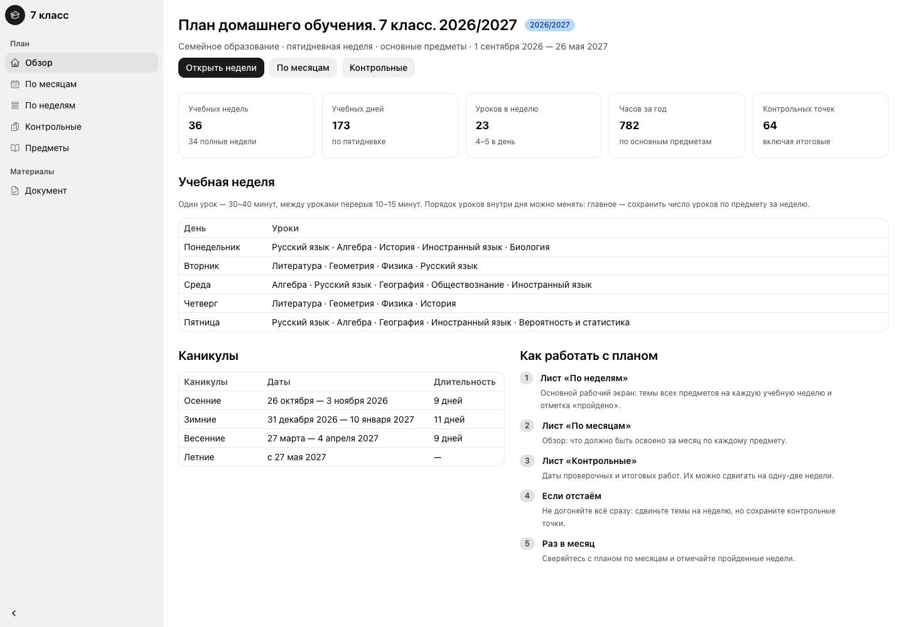
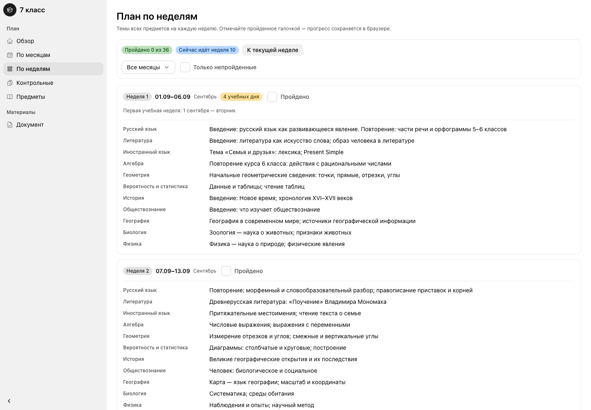

# План обучения. 7 класс. 2026/2027

Домашнее обучение (семейное образование), пятидневная неделя, основные предметы.

## Что лежит в папке

| Файл | Что это |
| --- | --- |
| [План_7_класс_2026-2027.xlsx](План_7_класс_2026-2027.xlsx) | Excel: обзор, план по месяцам и неделям, часы, контрольные, календарь |
| [План_7_класс_2026-2027.md](План_7_класс_2026-2027.md) | Тот же план текстом |
| [site/](site/) | Сайт на Vite + React + Astryx, готовый к GitHub Pages |
| [src/](src/) | Источник данных на Python: план, сборка Excel и Markdown |

## Как обновлять

1. Правки вносим в `src/plan_data.py`.
2. Пересобираем таблицу и текст:
   ```bash
   cd src
   python3 build_plan.py
   python3 build_markdown.py
   ```
3. Обновляем данные для сайта:
   ```bash
   python3 src/export_site_data.py
   ```
4. Сайт собирается командой `cd site && npm run build`.

Подробности по сайту — в [site/README.md](site/README.md).

## Скриншоты



